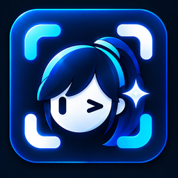

<p align="center">
  
</p>

<h1 align="center">CapParse</h1>

<p align="center">
  
  
</p>

Utilitário desktop para Windows, **local-first**: capture uma região da tela e transforme o conteúdo visual em texto utilizável. O OCR roda 100% localmente, sem conta e sem nuvem.

> **Estado atual:** o projeto está em desenvolvimento ativo. O pacote publicado é o **beta** [`v0.1.0-beta.3`](https://github.com/Sweetcheat/CapParse/releases/tag/v0.1.0-beta.3) — temas claro/escuro, Configurações acessíveis pela janela principal e pela bandeja, reconstrução de espaços no OCR e menor consumo de memória. Os pacotes anteriores (`v0.1.0-beta.1`, `v0.1.0-beta.2`) não incluem essas novidades — veja as [limitações conhecidas](#limitações-conhecidas). A branch `main` do repositório já inclui novidades que ainda **não estão em nenhum pacote publicado** (saem na próxima release): o **Modo Direto** (atalhos por ação e escolha do modo na primeira execução), a **confirmação visual própria** (toast) do resultado das capturas e o **tooltip do ícone da bandeja** com o último resultado — veja [Modo Direto](#modo-direto).

[Português](#português) | [English](#english)

---

<a id="português"></a>
## Português

### O que é o CapParse

O CapParse segue o conceito **Capture → Understand → Act**:

1. **Capture** — pressione `Ctrl + Shift + X` (ou use o menu da bandeja) e arraste para selecionar uma região da tela. A tela é "congelada" no momento da captura, com suporte a múltiplos monitores e DPI diferente por monitor.
2. **Understand** — o texto da região é reconhecido por OCR totalmente local (modelo PP-OCRv6 Small via ONNX Runtime). Nenhuma imagem ou texto sai do seu computador; não há telemetria, conta ou dependência de internet.
3. **Act** — o resultado é exibido na janela principal, onde você pode copiar o texto, copiar a imagem capturada ou salvá-la em arquivo.

### O que já funciona (implementado)

- Captura de tela congelada (freeze-frame) de todo o desktop virtual, com seleção por arraste;
- Suporte a múltiplos monitores, posições negativas e DPI diferente por monitor (PerMonitorV2);
- Cancelamento da seleção com `Esc`;
- OCR local de português e inglês (texto simples); o processamento não bloqueia a interface;
- Reconstrução conservadora dos espaços entre palavras no texto reconhecido;
- Menor consumo de memória no OCR (ajustes da sessão do ONNX Runtime, validados em avaliação A/B);
- Janela de resultados com texto selecionável e as ações explícitas **Copiar texto**, **Copiar imagem** e **Salvar imagem** (o aplicativo nunca copia para a área de transferência por conta própria);
- Cópia da imagem capturada para a área de transferência (colada em Paint, editores e outros aplicativos que aceitam imagem);
- Salvamento da imagem capturada em arquivo (diálogo padrão do Windows, PNG);
- Histórico da sessão em memória (resultados de capturas anteriores, na janela principal);
- Temas claro e escuro (segue a preferência do Windows ou a escolha em Configurações), aplicados a todas as janelas;
- Tela de configurações (pela **engrenagem na janela principal** ou pelo **menu da bandeja** — a mesma janela, uma instância por vez): alterar o atalho de captura, com persistência entre reinícios;
- Ícone na bandeja do sistema: **Capturar**, **Configurações**, **Sair**; duplo clique restaura a janela principal; o tooltip do ícone mostra o último resultado confirmado (ou um lembrete para configurar os atalhos quando o Modo Direto está ativo sem atalhos — branch `main`);
- Atalho global configurável (`Ctrl + Shift + X` por padrão); se o atalho salvo já estiver em uso por outro aplicativo, o CapParse ativa o padrão e avisa;
- **Modo Direto** (branch `main`, a partir da próxima release): atalhos globais por ação — **copiar imagem**, **OCR + copiar texto** e **salvar imagem** — que executam a ação imediatamente após a seleção, sem janela de resultados;
- Tela de primeira execução curta (exibida uma única vez), com a escolha do modo de uso (Tradicional, Direto ou adiar);
- Confirmação visual própria do aplicativo (toast no canto inferior direito, sem roubar o foco) do resultado das capturas e ações, nos dois modos; o tooltip do ícone da bandeja guarda o último resultado (branch `main`, a partir da próxima release);
- Indicador de processamento e diálogo de erro de captura com "tentar novamente";
- Instância única: um segundo lançamento não abre outra instância;
- Interface em português brasileiro.

### O que ainda não está disponível (planejado)

- Histórico com as imagens capturadas (o histórico atual mantém apenas o texto reconhecido — melhoria registrada no backlog).

### Requisitos do sistema

- Windows 10 ou 11, 64 bits (x64);
- O pacote beta é **self-contained**: não é necessário instalar o .NET, o Visual Studio ou usar terminal;
- OCR roda na CPU; o primeiro reconhecimento de cada sessão demora mais (carregamento do modelo), os seguintes são mais rápidos.

> A compatibilidade foi verificada no computador de desenvolvimento. O beta está sendo distribuído justamente para validar outros computadores — se algo não funcionar no seu, isso é um **bug a reportar**, não necessariamente incompatibilidade.

### Como executar a beta 3

1. Baixe o arquivo `.zip` da [release `v0.1.0-beta.3`](https://github.com/Sweetcheat/CapParse/releases/tag/v0.1.0-beta.3) ([link direto para o ZIP](https://github.com/Sweetcheat/CapParse/releases/download/v0.1.0-beta.3/CapParse-v0.1.0-beta.3-win-x64.zip)) e extraia em uma pasta (por exemplo, `CapParse`);
2. Se o Windows avisar (SmartScreen), clique em **Mais informações** → **Executar assim mesmo** — o pacote não é assinado digitalmente;
3. Execute `CapParse.exe`;
4. O aplicativo fica minimizado na bandeja do sistema. Pressione `Ctrl + Shift + X` para capturar, arraste para selecionar a região e solte o botão do mouse;
5. O texto reconhecido aparece na janela principal — use **Copiar texto**, **Copiar imagem** ou **Salvar imagem** (as capturas anteriores ficam no histórico da janela);
6. Para sair, use **Sair** no menu da bandeja (fechar a janela apenas a esconde).

SHA-256 do pacote: `7123857bf0610e1fdadca8611e0d664d19baf3a36dd207f06d7582f9c7b083de`

A pasta `models/` ao lado do executável contém os modelos de OCR (pasta `v6` + o classificador de orientação `v5`) — **não a remova**; sem ela o reconhecimento não funciona.

### Como alterar o atalho de captura

Abra **Configurações** pela engrenagem no canto superior direito da janela principal (ou pelo menu da bandeja), pressione a nova combinação na área de gravação e confirme. `Esc` cancela a alteração. A combinação precisa de `Ctrl`, `Alt` ou `Win` + uma tecla de letra, número ou F1–F24; se ela já estiver em uso por outro aplicativo, o CapParse volta ao padrão e avisa.

### Modo Direto

O Modo Direto (branch `main`; ainda não está em nenhum pacote publicado) troca a janela de resultados por atalhos que executam a ação imediatamente após a seleção da região:

- **copiar imagem** — a região é copiada para a área de transferência;
- **OCR + copiar texto** — o texto reconhecido é copiado para a área de transferência;
- **salvar imagem** — a região é salva em arquivo: política **Manual** (pede a pasta a cada ação) ou **Automático** (grava na pasta configurada, com nome único, sem sobrescrever arquivos).

Ativação: na tela de primeira execução (escolha **Modo Direto**) ou pelo toggle **Modo Direto** em **Configurações**. Nenhum atalho é pré-definido: após ativar, grave a combinação de pelo menos uma das três ações em **Configurações** — enquanto nenhum atalho existir, o tooltip do ícone da bandeja lembra que falta configurá-los.

No Modo Direto o atalho de captura tradicional fica inativo (a combinação é preservada e volta a valer ao retornar ao Modo Tradicional). O resultado de cada ação aparece em um toast próprio do aplicativo no canto inferior direito, sem roubar o foco do aplicativo em uso; o tooltip da bandeja mantém o último resultado.

### Compilando a partir do código-fonte

Requer o [.NET 8 SDK](https://dotnet.microsoft.com/download/dotnet/8.0) (ou mais novo) no Windows:

```powershell
git clone https://github.com/Sweetcheat/CapParse.git
cd CapParse
dotnet build
dotnet test
```

A pasta `models/v6` do repositório contém os modelos de OCR usados pelo aplicativo (o classificador de orientação v5 vem do pacote RapidOcrNet).

Variáveis de ambiente opcionais, apenas para diagnóstico (ao compilar e executar o próprio build):

- `CAPPARSE_TRACE=<caminho-para-arquivo>` — grava um log de diagnóstico detalhado (início do canal, ciclo de vida do ícone da bandeja, estágios da captura/OCR/cópia de texto) no arquivo indicado; sem a variável o canal fica inativo;
- `CAPPARSE_NO_OVERLAY=1` — diagnóstico temporário: captura o desktop sem criar as janelas de overlay (investigação de um flash de tela); a seleção de região fica desabilitada nesse modo.

Para gerar o pacote Windows x64 (self-contained: um único executável + pasta `models/`), use o script versionado:

```powershell
powershell -ExecutionPolicy Bypass -File build/publish-win-x64.ps1
```

O script executa restore, build, testes (incluindo os smoke tests de OCR com o modelo real), publish e empacotamento, e registra o tamanho e o SHA-256 do ZIP.

### Documentação

- [Product](docs/product.md) — objetivos, escopo e direção futura;
- [UI](docs/ui.md) — comportamento visual e experiência do usuário;
- [Arquitetura](docs/architecture.md) — arquitetura técnica e fronteiras;
- [Desenvolvimento](docs/development.md) — processo, marcos e continuidade entre sessões.

### Solução de problemas

- **O atalho não funciona:** outro aplicativo pode estar usando a combinação configurada. O CapParse avisa ao iniciar e ativa o atalho padrão; a captura continua disponível pelo menu da bandeja (**Capturar**) ou pela engrenagem da janela principal. O atalho pode ser alterado em **Configurações**.
- **A primeira captura "trava" por alguns segundos:** é o carregamento do modelo de OCR (apenas no primeiro reconhecimento da sessão).
- **Nada acontece ao capturar:** verifique se o aplicativo está na bandeja (ícone CapParse) e se não há outra instância aberta.
- **SmartScreen/antivírus:** o pacote beta não é assinado; alguns antivírus podem sinalizar executáveis desconhecidos. O código-fonte está disponível para inspeção.
- **O OCR não reconhece o texto:** imagens com muito ruído, resolução muito baixa ou fontes decorativas reduzem a precisão. O modelo atual é otimizado para texto simples em português e inglês.

### Limitações conhecidas

- Windows x64 apenas (o pacote beta não inclui outras plataformas);
- As novidades da branch `main` (Modo Direto, confirmação própria, tooltip da bandeja) **não estão em nenhum pacote publicado** — saem na próxima release;
- O histórico de resultados existe apenas em memória (é perdido ao sair do aplicativo) e mantém somente o texto reconhecido, não a imagem (melhoria no backlog);
- Os pacotes `v0.1.0-beta.1` e `v0.1.0-beta.2` não incluem as funções adicionadas depois (temas, engrenagem de Configurações na janela principal, reconstrução de espaços no OCR) — elas estão na `v0.1.0-beta.3`;
- O caminho de erro de captura (diálogo com "tentar novamente") foi inspecionado por código, mas sem gatilho reproduzível confirmado: não foi exercitado em teste automatizado nem em validação manual (risco residual documentado na M16-4);
- Durante o período de testes, o comportamento em computadores não validados pode revelar bugs — reporte-os.

### Privacidade

O CapParse é local-first: capturas, texto reconhecido e histórico nunca saem do seu computador. Não há telemetria, análise, upload automático ou chamadas de rede.

### Reportando bugs e enviando feedback

Durante o período de testes, abra uma [issue no GitHub](https://github.com/Sweetcheat/CapParse/issues) incluindo:

- versão do Windows e arquitetura (64 bits);
- o que você fez, o que esperava e o que aconteceu;
- se possível, uma captura de tela do comportamento.

### Licença

MIT — veja [LICENSE](LICENSE).

---

<a id="english"></a>
## English

### What is CapParse

CapParse is a local-first Windows desktop utility built around **Capture → Understand → Act**:

1. **Capture** — press `Ctrl + Shift + X` (or use the tray menu) and drag to select a screen region. The desktop is "frozen" at the moment of capture, with multi-monitor support and per-monitor DPI.
2. **Understand** — the region's text is recognized by a fully local OCR engine (PP-OCRv6 Small via ONNX Runtime). No image or text ever leaves your computer; there is no telemetry, no account and no internet dependency.
3. **Act** — the result is shown in the main window, where you can copy the text, copy the captured image, or save it to a file.

### What already works (implemented)

- Freeze-frame capture of the whole virtual desktop with drag selection;
- Multi-monitor support, negative positions and per-monitor DPI (PerMonitorV2);
- Cancel the selection with `Esc`;
- Local OCR for Portuguese and English (plain text); processing never blocks the interface;
- Conservative reconstruction of the spaces between words in the recognized text;
- Lower OCR memory footprint (ONNX Runtime session tuning, validated with an A/B evaluation);
- Results window with selectable text and the explicit actions **Copiar texto** (copy text), **Copiar imagem** (copy image) and **Salvar imagem** (save image) — the app never copies to the clipboard on its own;
- Copying the captured image to the clipboard (pastes into Paint, editors and other apps that accept images);
- Saving the captured image to a file (standard Windows dialog, PNG);
- In-memory session history (previous capture results, shown in the main window);
- Light and dark themes (follows your Windows preference or your choice in Settings), applied to all windows;
- A settings screen (from the **gear button on the main window** or from the **tray menu** — the same window, one instance at a time): change the capture hotkey, persisted across restarts;
- System tray icon: **Capturar**, **Configurações**, **Sair** (menu labels are in Portuguese); double-click restores the main window; the icon's tooltip shows the last confirmed result (or a reminder to configure shortcuts while the Direct Mode is on with none set — on the `main` branch);
- Configurable global hotkey (`Ctrl + Shift + X` by default); when the saved shortcut is already in use by another app, CapParse activates the default and tells you;
- **Direct Mode** (on the `main` branch, from the next release): per-action global shortcuts — **copy image**, **OCR + copy text** and **save image** — that run the action right after the selection, with no results window;
- A short first-run presentation (shown once), with the choice of how the app is used (Traditional, Direct, or defer);
- The app's own transient confirmation (a toast in the bottom-right corner, never stealing focus) for capture and action results, in both modes; the tray icon's tooltip keeps the last result (on the `main` branch, from the next release);
- A processing indicator and a capture-error dialog with a retry action;
- Single instance: launching a second copy does not start another instance;
- Brazilian Portuguese interface.

### What is not available yet (planned)

- History with the captured images (the current history keeps only the recognized text — a backlog improvement).

### System requirements

- Windows 10 or 11, 64-bit (x64);
- The beta package is **self-contained**: no .NET, Visual Studio or terminal required;
- OCR runs on the CPU; the first recognition of a session is slower (model loading), later ones are faster.

> Compatibility was verified on the development machine. The beta is being distributed precisely to validate other computers — if something does not work on yours, that is a **bug to report**, not necessarily an incompatibility.

### Running beta 3

1. Download the `.zip` from the [`v0.1.0-beta.3` release](https://github.com/Sweetcheat/CapParse/releases/tag/v0.1.0-beta.3) ([direct ZIP link](https://github.com/Sweetcheat/CapParse/releases/download/v0.1.0-beta.3/CapParse-v0.1.0-beta.3-win-x64.zip)) and extract it to a folder (e.g. `CapParse`);
2. If Windows warns you (SmartScreen), click **More info** → **Run anyway** — the package is not digitally signed;
3. Run `CapParse.exe`;
4. The app lives in the system tray. Press `Ctrl + Shift + X` to capture, drag to select the region and release the mouse button;
5. The recognized text appears in the main window — use **Copiar texto** (copy text), **Copiar imagem** (copy image) or **Salvar imagem** (save image); previous captures are kept in the window's history;
6. To quit, use **Sair** (Exit) in the tray menu (closing the window only hides it).

Package SHA-256: `7123857bf0610e1fdadca8611e0d664d19baf3a36dd207f06d7582f9c7b083de`

The `models/` folder next to the executable contains the OCR models (the `v6` folder plus the `v5` orientation classifier) — **do not delete it**; without it, recognition will not work.

### Changing the capture hotkey

Open **Configurações** (Settings) from the gear button at the top-right of the main window (or from the tray menu), press your new combination in the recording area and confirm. `Esc` cancels the change. The combination needs `Ctrl`, `Alt` or `Win` plus a letter, digit or F1–F24 key; if it is already in use by another app, CapParse falls back to the default and tells you.

### Direct Mode

The Direct Mode (on the `main` branch; not in any published package yet) replaces the results window with shortcuts that run the action right after the region selection:

- **copy image** — the region is copied to the clipboard;
- **OCR + copy text** — the recognized text is copied to the clipboard;
- **save image** — the region is saved to a file: **Manual** policy (asks for a folder on every action) or **Automatic** (writes to the configured folder, with a unique file name, never overwriting).

Activation: on the first-run presentation (choose **Modo Direto**) or through the **Modo Direto** toggle in **Configurações** (Settings). No shortcut is predefined: after enabling it, record a combination for at least one of the three actions in Settings — while none is set, the tray icon's tooltip reminds you to configure them.

In the Direct Mode the traditional capture hotkey is inactive (its combination is preserved and comes back when you return to the Traditional Mode). Each action's result appears in the application's own toast in the bottom-right corner, without stealing focus from the app you are using; the tray tooltip keeps the last result.

### Building from source

Requires the [.NET 8 SDK](https://dotnet.microsoft.com/download/dotnet/8.0) (or newer) on Windows:

```powershell
git clone https://github.com/Sweetcheat/CapParse.git
cd CapParse
dotnet build
dotnet test
```

The repository's `models/v6` folder contains the OCR models used by the application (the v5 orientation classifier ships inside the RapidOcrNet package).

Optional environment variables, for diagnostics only (when building and running your own build):

- `CAPPARSE_TRACE=<path-to-file>` — writes a detailed diagnostic log (channel startup, tray icon lifecycle, capture/OCR/text-copy stages) to the given file; without the variable the channel is inactive;
- `CAPPARSE_NO_OVERLAY=1` — temporary diagnostic: captures the desktop without creating the overlay windows (screen-flash investigation); region selection is disabled in this mode.

To produce the Windows x64 package (self-contained: a single executable + the `models/` folder), run the versioned script:

```powershell
powershell -ExecutionPolicy Bypass -File build/publish-win-x64.ps1
```

The script performs restore, build, tests (including the OCR smoke tests with the real model), publish and packaging, and records the ZIP's size and SHA-256.

### Documentation

- [Product](docs/product.md) — goals, scope and future direction;
- [UI](docs/ui.md) — visual behavior and user experience;
- [Architecture](docs/architecture.md) — technical architecture and boundaries;
- [Development](docs/development.md) — process, milestones and cross-session continuity.

### Troubleshooting

- **The hotkey does nothing:** another application may be using the configured combination. CapParse warns at startup and activates the default shortcut; capture remains available from the tray menu (**Capturar**) or the main window's gear button. The shortcut can be changed in **Configurações** (Settings).
- **The first capture "freezes" for a few seconds:** that is the OCR model loading (only on the first recognition of a session).
- **Nothing happens when capturing:** make sure the app is in the tray (CapParse icon) and that no other instance is running.
- **SmartScreen/antivirus:** the beta package is unsigned; some antivirus products may flag unknown executables. The source code is available for inspection.
- **OCR does not recognize the text:** noisy images, very low resolution or decorative fonts reduce accuracy. The current model is optimized for plain Portuguese and English text.

### Known limitations

- Windows x64 only (the beta package does not include other platforms);
- The `main` branch's new features (Direct Mode, the own confirmation toast, the tray tooltip) are **not in any published package** — they will ship in the next release;
- The results history is in-memory only (lost when the app exits) and keeps only the recognized text, not the image (a backlog improvement);
- The `v0.1.0-beta.1` and `v0.1.0-beta.2` packages do not include the features added later (themes, the settings gear button on the main window, OCR space reconstruction) — they are in `v0.1.0-beta.3`;
- The capture-error path (the dialog offering a retry) was inspected in code, but there is no confirmed reproducible trigger: it has not been exercised by an automated test or manual validation (residual risk documented in M16-4);
- During the testing period, behavior on unvalidated computers may reveal bugs — please report them.

### Privacy

CapParse is local-first: captures, recognized text and history never leave your computer. There is no telemetry, analytics, automatic upload or network calls.

### Reporting bugs and sending feedback

During the testing period, open an [issue on GitHub](https://github.com/Sweetcheat/CapParse/issues) including:

- Windows version and architecture (64-bit);
- what you did, what you expected and what happened;
- if possible, a screenshot of the behavior.

### License

MIT — see [LICENSE](LICENSE).
